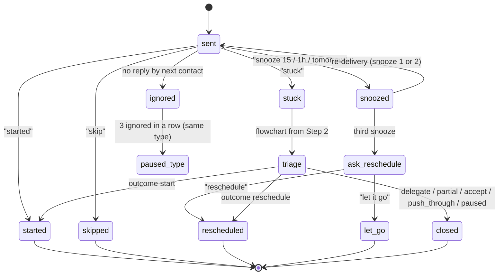

# Routines (drafts)

> Grok Bot routines use plain-language schedules (at least 5 minutes apart, in the timezone set in Settings). They can also start from triggers such as email or webhook. See [research](../docs/research-grok-bot.md#routines). **Every routine is opt-in, off by default, and only sends a nudge.** No routine acts on the person's behalf (see [guardrails](guardrails.md#3-no-outbound-actions-without-an-explicit-yes)).
>
> **Load cap:** by default the Bot makes **at most 3 proactive contacts a day**: an optional morning plan, start nudges at times the person chose, and an optional end-of-day review. The person can choose 0–5 a day; **5 is a hard ceiling**. An unanswered nudge is never followed up (guardrails §3.7).

This file describes the routines of the ADHD productivity Bot (see [PIVOT.md](../docs/PIVOT.md)). Onboarding collects goals, recurring tasks, deadlines and reminder preferences. The routines below check in at the times the person chose. When a check-in finds the person stuck, the [triage](skills/triage/SKILL.md) skill runs the flowchart (`data/flowchart.json`) in the moment.

Routine IDs R1, R2, R4 and R5 keep their old meaning, because the skills refer to them: R2 is the planned-start nudge and R5 is the clinician nudge. The old R3 (the user-requested "do you want to be doing this?" timer) is now part of the mid-day check-in (R3) and of snooze.

---

## 1. Platform facts and unknowns

Sources: [research-adhd-productivity.md Part C](../docs/research-adhd-productivity.md#part-c-grok-bot-scheduling-verified-vs-unknown) and [research-grok-bot.md](../docs/research-grok-bot.md#routines). Docs fetched 2026-10-31.

| Topic | Status | What we do about it |
|---|---|---|
| Output goes to the Bot's chat | **Verified** | Chat is the guaranteed channel. Every nudge must make sense when it's read late. |
| Push notifications | **Partly verified.** Per-Bot switch plus device permission. iPhone push is "rolling out gradually". The docs don't say whether a routine result counts as "finishes". | Push is best-effort. We never rely on it for anything time-critical. |
| Plain-language recurring schedules ("every weekday at 8:00 AM", "every 2 hours") | **Verified.** At least 5 minutes apart. | All routines here are recurring, written as the Bot expects. |
| One-off schedules | **Unknown**, not documented. A new routine waits for its next scheduled time. | Snooze and body-doubling timing depend on a spike (§5, §R6). We have a fallback for each. |
| Timezone | **Verified.** Settings → Bot → Timezone. Auto-detect follows the computer. A routine can have its own zone. | Onboarding confirms the timezone. Every routine prompt names the person's home timezone, so travel doesn't silently move nudges. |
| Quiet hours, do-not-disturb, snooze | **Not documented** | We build them into every schedule (§3, §5). |
| Bot creates and changes routines from chat | **Verified.** Auto Review covers "automation writes", so creating a routine may ask for approval. | Each routine is created only after a preview and an explicit "yes". |
| Pause and delete | **Verified.** Switch on the row; delete can't be undone. | "pause" uses the switch; "stop" deletes on request (§7). |
| Platform may pause routines after a long time away | **Verified** ("may ask whether to keep routines running ... and pause them if there is no response") | Fits our own 7-day pause (R8). We never fight it. |
| Limits | **Verified.** 50 routines per Bot; 300 runs/hour overall; 200/hour per routine; **each run spends usage** from the weekly pool. | The default setup uses 3 routines, about 15–21 runs a week. |
| Routines reading Sheets or Calendar | **Likely, not explicit.** Runs "can call connected tools". | Memory is the default store. The Sheet is optional. |
| Calendar writes | **Capability verified; approval unknown.** Approvals from a routine "expire after about 30 minutes". | Calendar changes are only ever proposed, with a "yes" per action. A routine-proposed block that expires is dropped, not retried. |
| A routine run that decides to post nothing | **Unknown** | Matters for empty start-nudge slots and quiet-hours checks. Part of the spike. Fallback: R2 slots are only created for times that will normally have a task. |

**Spike (before build):** test a one-off schedule ("in 15 minutes", "today at 3:40 PM"), a routine that posts nothing, a routine that changes or pauses another routine, push delivery of a routine result on iPhone and Android, and a Sheets write from a routine run. Record results, with dates, in the research doc.

---

## 2. Cadence

**Contact types.** A *scheduled contact* is a routine run that messages the person without being asked: R1, R2, R3, R7, and R4 on its day. A *requested follow-up* is a message the person asked for just now: a snooze re-delivery, or the halfway or end check of a body-doubling session they started. Requested follow-ups don't count toward the daily cap, but they have their own limits (at most 2 snoozes per nudge; at most 2 messages per session).

**Defaults.** The suggested setup offers 3 scheduled contacts a day. Each one needs its own "yes". The person may choose anywhere from 0 to 5. The Bot refuses a sixth and offers to swap one out instead. With 0 contacts, the Bot still works when the person opens the chat.

**Why 3:** batching notifications about 3 times a day beat hourly batching, and turning them all off raised anxiety (Fitz 2019, a single trial with replication needed). Notifications cost attention even when ignored (Stothart 2015) and raised self-reported inattention (Kushlev 2016). Reminder effects fade with repetition. See [research §5](../docs/research-adhd-productivity.md#5-notification-fatigue-habituation-timing-and-jitais).

**Event-based cues.** Time-based prospective memory looks weaker than event-based in ADHD (Altgassen, unverified details; [research §1](../docs/research-adhd-productivity.md#1-reminders-and-prompting)). Routines can only fire on a clock (or on email or webhook triggers, which few people will use). So each start nudge is anchored to the person's own if-then cue: it is scheduled a few minutes before the cue event and worded around it ("When you sit back down after lunch, ...").

**Bundling.** If two items fall in the same slot, they go into one message, not two.

**Rotation.** Every template below has 2–3 variants. The Bot rotates them in order and never sends the same wording twice in a row for the same routine.

### Daily load budget

| Routine | In the suggested setup | Scheduled contacts a day (default) | If the person changes it |
|---|---|---|---|
| R1 Morning plan | Offered | 1 | 0 if declined |
| R2 Start nudge | 1 slot offered | 1 | +1 per extra slot |
| R3 Mid-day check-in | Off | 0 | 1 if turned on |
| R6 Body-doubling session | Started by the person | 0 (requested follow-ups only) | — |
| R7 End-of-day review | Offered | 1 | 0 if declined |
| R4 Weekly reflection | Off | 0 (on its day it **replaces** R7, so it adds nothing) | — |
| R5 Clinician nudge | Off | 0 (a paragraph inside R4, at most once every 4 weeks) | — |
| R8 Welcome back | Rule, not a contact | 0 (replaces the next contact, once per gap) | — |
| **Total** | | **3** | **0–5, hard ceiling 5** |

Example 5-contact day: R1 + 3 × R2 + R7. Example light day: one R2 slot only.

**Usage cost:** at the default, about 15 runs a week on weekdays or 21 every day. The preview tells the person this ("3 check-ins a day uses some of your weekly Grok Bot usage").

---

## 3. Quiet hours

- The platform documents no quiet hours or do-not-disturb, so **we build them into every schedule**.
- The default is **21:00–08:00 local time**. Onboarding asks: "When should I never message you? The default is 9 PM to 8 AM."
- The Bot never creates a routine whose time falls inside quiet hours. If the person asks for one ("nudge me at 11 PM"), the Bot checks once: "That's inside your quiet hours. Move your quiet hours, or pick another time?"
- Snoozes that would land inside quiet hours carry to the next scheduled contact instead ("tomorrow" means the first contact after quiet hours end).
- Every routine prompt also tells the Bot: "If the local time in {home timezone} is inside {quiet hours}, post nothing." This is a backstop for timezone changes. Whether a run can post nothing is part of the spike.
- Quiet hours apply to scheduled contacts and requested follow-ups alike. If the person is chatting live at 23:00, the Bot simply replies; quiet hours govern only what the Bot starts.

---

## 4. Routine catalogue

Placeholders: `{task}` is the person's own task name, `{first_step}` its first physical step, `{cue}` the situation from its if-then plan, `{time}` the planned time. Reply options are typed words; the docs describe no buttons. Square brackets show the replies offered.

All templates follow guardrails: no "proven", "evidence-based" or "dopamine"; no "your ADHD" unless the person brings it up; any sign of distress stops the flow and goes to [guardrails §2](guardrails.md#2-crisis-and-safety).

Evidence tags use the levels in the research doc (Strong / Moderate / Weak / None) and, for anything said to the person, the plain-word honesty labels in `data/flowchart.json` ("well supported", "reasonable but untested", "a hack some people like").

### R1. Morning plan (optional)

- **Schedule example:** "every weekday at 8:30 AM" (the person picks the time; must be after quiet hours end).
- **Suggested setup:** offered. Off until the person says yes to the preview.
- **What it does:** lists today's planned tasks and deadlines, confirms which task goes in which start-nudge slot, and asks for one change at most. It may *propose* a calendar block, which needs a yes for that one action and expires after about 30 minutes if it came from the routine.
- **Template:**
  - A: "Morning. Today's plan: **{task}** at {time} (first step: {first_step}). Keep it, change it, or skip today? [keep] [change] [skip today]"
  - B: "Good morning. One thing lined up: **{task}**, when {cue}. Still the right one? [keep] [change] [skip today]"
  - C: "Hi. {deadline_task} is due {deadline_day}. Want today's slot for that, or for **{task}**? [{deadline_task}] [{task}] [skip today]"
- **Replies:** "keep" confirms the slots. "change" opens a short re-plan (one question at a time). "skip today" quietly skips today's R2 nudges and says one line: "Got it, no nudges today. I'm here if you want me."
- **Reads:** goals, tasks, deadlines, slot times (memory, or the Sheet `Tasks` and `Settings` tabs). **Writes:** today's task-to-slot plan (memory). A Check-ins row only if logging is on.
- **Evidence tag:** planning prompt. Personalised reminders: Moderate in general adults (Head 2013; Fry & Neff 2009), not tested in ADHD adults. Prioritising (`prioritize_top3`): reasonable but untested.

### R2. Start nudge (one per planned task slot)

- **Schedule example:** "every weekday at 1:55 PM" (a few minutes before the cue "when I sit back down after lunch"). For a recurring task: "every Monday and Thursday at 6:00 PM". Each slot is one recurring routine. The task in a slot comes from the morning plan, or from the task's own recurrence.
- **Suggested setup:** 1 slot offered. Off until the person says yes.
- **Why slots, not one routine per task:** one-off schedules aren't documented, and recreating routines every day would mean many approval prompts. Slots are recurring and stable.
- **Template:**
  - A: "{cue}: time for **{task}**. First step: {first_step}. [started] [snooze] [stuck] [skip]"
  - B: "It's about {time}, your slot for **{task}**. Just this: {first_step}. [started] [snooze] [stuck] [skip]"
  - C: "**{task}**. Smallest start: {first_step}. Want to go now? [started] [snooze] [stuck] [skip]"
- **Replies:** see the state machine (§6). "started" gets one short line ("Nice. Tell me how it went later if you like.") and an offer of R6 only if the task is long. "stuck" opens triage at Step ② with the task already known (see triage, "Entry from a check-in"). If the task itself turns out to be unclear, triage goes back to Step ①.
- **Reads:** the task, its first step, its if-then cue, its estimate. **Writes:** the response and snooze count (memory, or a `Check-ins` row if logging is on). A win on "started".
- **Evidence tag:** if-then plans: Strong in general (d = 0.65, Gollwitzer & Sheeran 2006), Moderate in lab tasks with ADHD children, **None** in ADHD adults. SMS reminders: Moderate (Thakkar 2016). Event-based framing: Weak/Moderate (Altgassen). Plain words to the person: "reasonable but untested". The `smallest_step` strategy itself is "well supported".

### R3. Mid-day check-in (optional)

- **Schedule example:** "every weekday at 12:30 PM".
- **Suggested setup:** off. Offered later only if the person asks for more support. It counts toward the cap (it would be contact 4 unless something else is dropped).
- **What it does:** a light "where are you?" check that also covers the old inertia interrupt from the chart ("Set a check-in alarm: do you want to be doing this?", `recurring_alarm`).
- **Template:**
  - A: "Mid-day check. Is what you're doing right now what you want to be doing? [yes] [stuck] [re-plan] [skip]"
  - B: "Quick one: how's **{task}** going? [started] [not yet] [stuck] [skip]"
  - C: "Halfway through the day. One thing you'd still like to start? [tell you] [stuck] [skip]"
- **Replies:** "stuck" opens triage. If they're in a scroll loop, triage usually routes to Step ③ INERTIA (`interrupt_inertia`). "not yet" offers snooze or carry-over.
- **Reads:** today's plan. **Writes:** a `Check-ins` row if logging is on.
- **Evidence tag:** `recurring_alarm`: reasonable but untested (claim Weak/Moderate). Frequent interruptions cost attention (Stothart 2015; Kushlev 2016, Moderate), which is why this is off by default.

### R6. Body-doubling session (started by the person)

- **Trigger:** the person says "body double 25", "focus 50 on {task}" or similar. Not a schedule. Length is 25 or 50 minutes.
- **Suggested setup:** available any time, nothing to turn on. The halfway check is off by default.
- **Start (live reply):**
  - A: "I'm here. 25 minutes on **{task}**, ending around {end_time}. What's the goal for this block, in one line?"
  - B: "OK, 50 minutes, until {end_time}. Tell me what 'done for this session' looks like, then go."
- **Halfway (optional, requested follow-up):**
  - A: "Halfway. {minutes_left} minutes left. Still on **{task}**? No need to reply."
  - B: "Half done. Keep going; I'll check back at {end_time}."
- **End (requested follow-up):**
  - A: "Time. You aimed for: '{session_goal}'. How did it go? [done] [part done] [got stuck] [keep going]"
  - B: "That's {length} minutes. What did you get done? Anything counts. [done] [part done] [got stuck] [keep going]"
  - C: "Session over. Want to log a win, take a break, or go another round? [win] [break] [another round]"
- **Timing:** halfway and end need a one-off schedule (**unknown**, spike). Fallback: the Bot suggests a phone timer placed across the room (guardrails §4) and the person reports back when it rings. If they don't, the report-back is asked once at the next scheduled contact, then dropped.
- **Limits:** at most 2 Bot messages per session (halfway + end). "keep going" starts a new session with a new goal; at most 2 rounds in a row before suggesting a break.
- **Reads:** the task. **Writes:** a `Sessions` row (goal, length, result) and a win on "done" or "part done".
- **Evidence tag:** body doubling has **no peer-reviewed outcome data** (Eagle & Ringland 2024 is descriptive). The audience effect helps simple tasks and hurts complex ones (Bond & Titus 1983). The strategy `body_double` is "reasonable but untested". Bot copy says: "Lots of people like this. It hasn't been tested in trials, so treat it as an experiment." No productivity claims. Showing elapsed and remaining time is worth trying given robust time-perception deficits (Marx 2022), but there's no adult evidence that timers help.

### R7. End-of-day review (optional)

- **Schedule example:** "every weekday at 6:30 PM" (must end before quiet hours).
- **Suggested setup:** offered. Off until the person says yes.
- **Order:** what went well first. Then, only if they want: what's carrying over. Estimated-vs-actual time is optional and off unless the person turns it on.
- **Template:**
  - A: "End of the day. What went well, even a small thing? [tell you] [nothing today] [skip]"
  - B: "Today you started **{task}**. That counts. Anything else you'd like on the wins list? [add a win] [carry something over] [skip]"
  - C: "Wrapping up. One good thing from today? Then we can move anything unfinished to tomorrow. [tell you] [carry over] [skip]"
- **"nothing today":** "That's OK. Some days are like that. Want to pick one tiny thing for tomorrow, or just rest? [tomorrow] [rest]". Never "you missed".
- **Optional time line (if on):** "You guessed {est} minutes for **{task}**; it took about {actual}. Useful for next time, not a score."
- **Logging:** if the Sheet is on, this is when the day's rows are shown as one batch and written after one "yes" (see [sheet-design.md](../docs/sheet-design.md)).
- **Reads:** today's responses and wins. **Writes:** wins, carry-overs to tomorrow's plan, optional actual minutes.
- **Evidence tag:** progress monitoring that is reported helps in general (Harkin 2016, Moderate; Weak in ADHD). Wins-first ordering is a design choice, not tested. Time feedback: reasonable but untested.

### R4. Weekly reflection (optional)

- **Schedule example:** "every Sunday at 5:00 PM". On that day it **replaces** R7, so the daily total doesn't rise.
- **Suggested setup:** off. Offered after the first week if the person is still using the Bot.
- **Template (wins first, counts only go up):**
  - A: "Your week: you showed up on {days_showed_up} days and started {starts} things. Biggest win: {top_win}. 'Break it down' helped most. Anything you'd like to change for next week? [keep as is] [change a time] [fewer nudges] [skip]"
  - B: "Week wrap. {wins_count} wins logged so far this month. The thing that helped most was {top_strategy}. Want to tweak anything? [keep as is] [change] [skip]"
  - C: "Quick look back: {starts} starts this week. Any nudge that's been more annoying than useful? [that one] [all fine] [skip]"
- **Never:** "you missed X days", failure counts, red marks, comparisons with last week that go down.
- **Reads:** memory counts, or the Sheet `Summary` tab. **Writes:** settings changes the person asks for (each with a one-line confirmation).
- **Evidence tag:** progress monitoring (Harkin 2016, Moderate general). Asking about annoying nudges addresses habituation (Weak, consistent signal).

### R5. Clinician nudge (rare, opt-in)

- **Trigger:** not a schedule of its own. Inside R4, if over the last 4 weeks most stuck walks ended at Step ④ or ⑤ (outcomes `accept` or `push_through`, or repeated loops). At most once every 4 weeks. Only if the person opted in during onboarding or later ("Is it OK if I occasionally mention getting outside help?").
- **Suggested setup:** off.
- **Template:**
  - A: "I've noticed a lot of weeks where starting has been really hard, even with lots of strategies. That's not a willpower problem. Talking to a doctor or ADHD specialist could help, and I can help you write down what you'd want to say. [help me write it] [not now] [don't mention this again]"
  - B: "Starting has been rough for a while now. If you have a doctor or clinician, it might be worth bringing up. I can help you jot down a few notes for that. [notes] [not now] [don't mention this again]"
- **"don't mention this again"** turns R5 off permanently, with a one-line confirmation.
- **Reads:** outcome counts only. **Writes:** nothing. No health details are stored.
- **Evidence tag:** medication and structured CBT/DBT programmes have far more evidence than any single tip (evidence_review.md takeaway 10; [guardrails §1](guardrails.md#1-not-medical-advice)). Living SMART, the best adult digital trial, included a human coach (Moëll 2015).

### R8. Gap / welcome back

- **Trigger:** a rule checked by every routine run, not a separate schedule. If the person hasn't replied for 7 days, the next scheduled contact is replaced by one note, then all routines are paused (switch off, not deleted). If the platform's own long-absence pause happens first, we let it stand and send nothing extra.
- **Template (sent once per gap):**
  - A: "I've paused your check-ins so I'm not cluttering your chat. Welcome back any time; just say hi and we'll pick one small thing."
  - B: "Nudges are paused for now. No catching up needed when you're back. One message and we'll start fresh."
- **On return (live reply):** "Welcome back. Want your old check-ins back on, a lighter version, or just help with one thing right now? [all back] [lighter] [one thing]". No summary of what was missed. Old tasks are offered, never listed as overdue.
- **Fallback:** if a routine run can't pause other routines (spike), each routine prompt says "if no reply in 7 days and the welcome-back note was already sent, post nothing", and the Bot asks the person to confirm the pause when they return. Silent runs still spend usage, so this fallback is noted in the preview.
- **Reads:** last-reply date. **Writes:** routine pause state.
- **Evidence tag:** steep app drop-off is Strong (Baumel 2019: 3.3% 30-day retention), so we design for coming back. No-guilt re-entry is a design choice; there's no peer-reviewed study of streak shame.

---

## 5. Snooze

- Replies: **"snooze 15"**, **"snooze 1h"** or **"tomorrow"**. A bare "snooze" means 15 minutes.
- **At most 2 snoozes per nudge.** On the third: "Want to reschedule it, or let it go for today? [reschedule] [let it go]". "reschedule" uses the `reschedule` strategy as an if-then plan ("At [time], at [place], I will [first physical action]"). "let it go" drops it without comment.
- **Mechanism depends on a spike:** a snooze needs a one-off schedule, which isn't documented. If the spike shows one-off schedules work, a snooze creates a single-run routine and deletes it after it fires. If not, the **fallback** is to carry the item to the next scheduled contact ("I'll bring it up at 6:30"). We never create a frequent recurring routine just to emulate snooze, because each run spends usage.
- A snooze that would land inside quiet hours carries over to the first contact after quiet hours.
- "tomorrow" moves the item to tomorrow's morning plan, or to the same slot tomorrow if R1 is off.
- Snooze re-deliveries use a different wording variant from the original nudge.

---

## 6. Escalation limits

**No escalation in tone or frequency, ever.**

- An unanswered nudge is **never followed up**. No "just checking again", no second message, no stronger wording.
- A nudge is counted as **ignored** if there's no reply before the next scheduled contact (or before quiet hours start, for the last one of the day).
- **After 3 ignored nudges in a row of the same type** (for example, the 1:55 PM start slot), pause that type and ask once, at the next contact: "I've paused the 1:55 nudges since they haven't been landing. Bring them back, move them, or leave them off? [back] [move] [leave off]". Three is a heuristic, not a tested threshold.
- **After 7 days with no reply at all**, pause everything and send one welcome-back note (R8).
- Snoozes are capped at 2 per nudge (§5). Body-doubling messages are capped at 2 per session (R6).
- The daily cap (default 3, chosen 0–5, ceiling 5) is never raised by the Bot itself, only by the person, and never above 5.

### Nudge state machine

| From | Event | To | What the Bot does | Logged response |
|---|---|---|---|---|
| sent | "started" | started | One short encouraging line. Adds a win. | `started` |
| sent | "snooze …" (1st or 2nd) | snoozed | One-line confirmation with the new time. | `snoozed`, count +1 |
| snoozed | time reached (or next contact, in fallback) | sent | Re-delivers with a new wording. | — |
| snoozed | 3rd snooze | ask_reschedule | "Reschedule, or let it go?" | `snoozed`, count 3 |
| sent | "stuck" | stuck → triage | Runs the triage skill. Ends with the flowchart terminal outcome. | `stuck`, with path and outcome |
| triage | outcome `start` | started | "Hell yeah, get started!" Adds a win. | outcome `start` |
| triage | outcome `reschedule` | rescheduled | If-then plan; offers an R2 slot (yes needed). | outcome `reschedule` |
| sent | "skip" | skipped | "OK." Nothing else. | `skipped` |
| sent | no reply | ignored | Nothing. Ever. | `none` |
| ignored ×3 same type | — | paused_type | Asks once at the next contact (§6). | — |

---

## 7. Opt-out

- **"stop"**, **"pause"**, **"fewer"** and **"change time"** take effect **immediately** and get a **one-line confirmation**. They work per routine ("stop the morning one") or for everything ("stop all").
  - "pause" → switch the routine off. "Paused the morning plan. Say 'resume' any time."
  - "stop" → switch off and offer deletion. "Stopped. Want me to delete it too? It can't be undone. [delete] [keep it paused]". Routines are deleted on request.
  - "fewer" → drop to the next lower count, removing the lowest-value contact first (R3, then extra R2 slots, then R1). "Down to 2 a day: the 1:55 nudge and the evening review."
  - "change time" → asks for the new time, checks quiet hours, confirms in one line.
- No guilt, no "are you sure?" chains, no "you'll lose your progress" (there's no streak to lose).
- If the request is ambiguous ("stop"), the Bot pauses everything first and asks which one second. Pausing is safe and reversible.
- Platform controls also work: the routine's switch, swipe-to-delete on mobile, the per-Bot notification switch, and the phone's notification toggle.

---

## 8. Onboarding: creating a routine

1. Ask about 3 questions to start: one goal or task, a time or cue for it, and quiet hours (default 21:00–08:00). Timezone is confirmed from Settings. The rest is learned over time.
2. **Preview each routine** before creating it: schedule in plain words, a sample message, what it reads and writes, and its usage cost. Example: "I'd set this up: *every weekday at 1:55 PM*, a nudge for 'Email landlord', first step 'open Gmail and type the subject line'. It uses a little of your weekly Grok Bot usage. Create it? [yes] [change] [no]"
3. Create it only after an explicit **"yes"** for that routine. Silence, "maybe" or "sure, whatever you think" for a different item is a no (guardrails §3.2).
4. Memory stores the plan (opt-in: "Want me to remember this?"). The Sheet is optional, for history. No health details go in either.
5. After setup, the Bot lists the active routines in one message, and says how to say "fewer" or "stop".

---

## 9. What this design does NOT do

- Send more than 5 scheduled contacts a day, or more than 3 unless the person chose more.
- Follow up on an unanswered nudge, or escalate tone or frequency.
- Message during quiet hours.
- Use streaks that reset, missed-day counts, "you missed X days", red marks or guilt on return.
- Rely on push notifications for anything important.
- Create, change or delete a routine without a preview and a "yes".
- Write to the calendar, send email, or message anyone. Calendar changes are proposals with a yes per action; routine-originated approvals that expire are dropped.
- Create frequent routines just to emulate snooze or timers.
- Store health details, diagnoses or medication.
- Claim the Bot is a treatment, or that any routine is "proven". Body doubling is presented as untested.
- Adapt by sensing (location, activity, phone use). Adaptation is limited to simple rules: replies, ignored counts, time of day. JITAI effects are not established in ADHD.
- Replace human support. R5 points towards clinical care when it seems useful, and the person can add an accountability partner themselves (the Bot only drafts messages for them to send).
